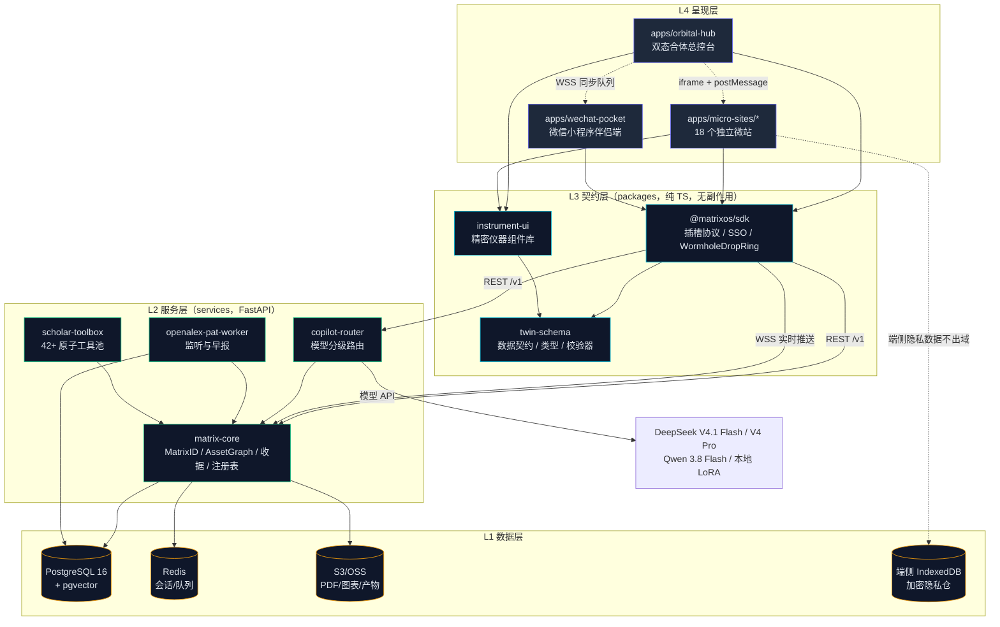
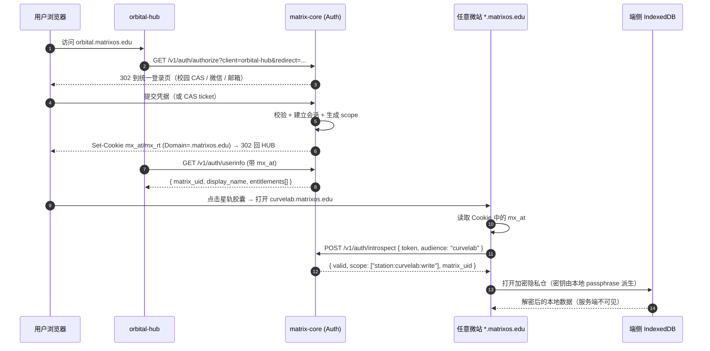
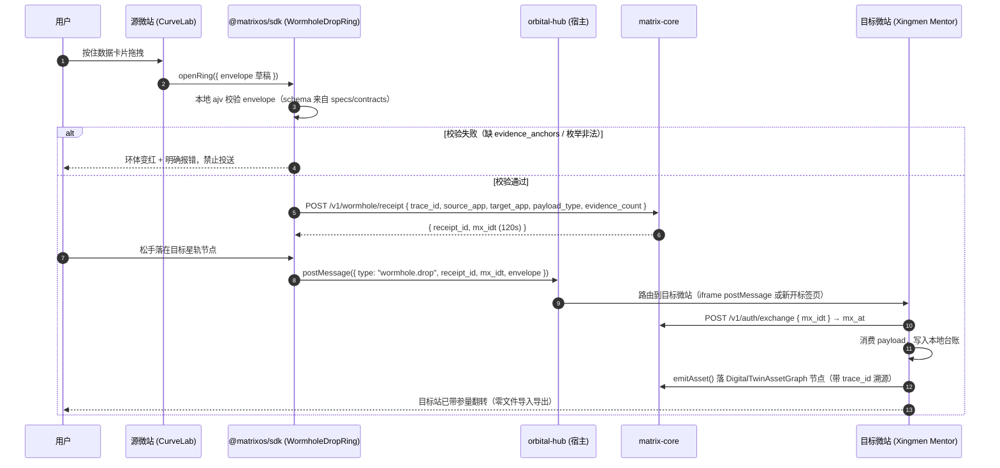
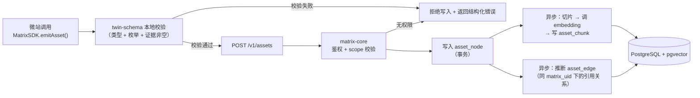

# MatrixOS v3.0 目标架构设计

> 文档编号：docs/01-plan/01-architecture.md
> 状态：Stage 0 规划基线（可执行）
> 上游依据：`bundle/MatrixOS_v3_完整交互规范与UI图谱_高清版.html`（**v3 唯一权威架构源**，见 `00-adr-000-spec-authority.md`）、`specs/microsites.json`（18 站权威花名册）、`specs/contracts/*.schema.json`（已落地契约）
> 降级参考：`bundle/matrix_os_agent_execution_spec.md` 为 **v2 时代旧稿**，依 ADR-000 仅作历史追溯。本文仅在其「42+ 工具池归属」与「四阶段框架」两处借用其思路，均已按 v3 体系改造（见 §9）
> 下游消费：`02-roadmap.md`、`03-work-breakdown.md`、`04-tech-decisions.md`

---

## 1. 架构总览与设计公理

MatrixOS v3.0 是对四个已上线原型（ScholarMatrix 42+ 工具、星门 Xingmen、PAT-HOT、预职 Pre-Job）的**解耦重构**，不是新建项目。架构的最高约束是：**把「一个大而全的工具集合」拆成「18 个职责单一、独立部署、独立台账、可单独下线的微站」，同时保持账号、数据、AI 副驾驶、跨站数据流四件事在全局唯一。**

由此导出的 5 条不可协商的架构公理（对应蓝图 Q1–Q5，均已在原设计中锁定，本文只做工程落地，不重新论证产品方向）：

| 公理 | 内容 | 工程含义 |
| :--- | :--- | :--- |
| A1 群岛式微站 | 18 个官方旗舰微站，各自独立二级域名 `*.matrixos.edu`、独立持久化台账 | 每个微站是一个独立 Next.js 应用与独立构建产物，一个站崩不连带其他站 |
| A2 单一身份与资产底座 | 全域共享唯一 `MatrixID`（OAuth2 + JWT）与 `DigitalTwinAssetGraph`（PostgreSQL + pgvector + 端侧 IndexedDB） | 鉴权与资产服务是**全站唯一单点**，微站不得自建用户表、不得自建资产库 |
| A3 全局副驾驶 + 虫洞 | 18 站共享唯一 Global Copilot，跨站拖拽经 `WormholeDropRing` 带证据锚点翻转 | 虫洞是**纯客户端 + 契约校验**的机制，不走服务端大包中转 |
| A4 双态合体导航 | `orbital.matrixos.edu` 左 32% 星轨 + 右 68% 仪器架 + 底部声波坞；可 `↗ 全屏独立打开` | 主入口用**多 iframe 挂载**同屏展示微站，微站必须能在 iframe 内降级运行 |
| A5 开放插槽 | `@matrixos/sdk` + `matrix-app.manifest.json` 让第三方实验室热插拔第 19+ 站 | 微站注册是**数据驱动**的（manifest → 星轨插槽），不是硬编码路由表 |

**这五条公理直接决定了下面所有模块边界：**

- A2 决定了 `specs/contracts/` 是唯一契约源，`services/` 里只允许有一个身份与资产服务（本文称 `matrix-core`，见 §3.3）。
- A4 决定了微站必须支持 iframe 嵌入与跨窗口消息通道，这是微站模板的**强制能力**，不是可选项。
- A5 决定了星轨导航读的是 manifest 注册表，第三方站与官方站走同一条挂载路径。

---

## 2. Monorepo 目录结构

严格遵循蓝图 §3 的 `Turborepo + Next.js 15 + FastAPI` 结构，并补齐工程落地必需项。蓝图原文标记的每一项均保留，新增项以 `# [+]` 标注。

```text
matrix-os-v3/
├── apps/
│   ├── orbital-hub/                 # 主入口：左32%星轨球 + 右68%折射仪器架 + 底声波脉冲坞
│   ├── micro-sites/                 # 18 个独立部署、单一职责的微站应用 (*.matrixos.edu)
│   │   ├── 01-gpa-sandbox/          # 学阶 · 学分绩点动态配重台          → gpa
│   │   ├── 02-spark-teaming/        # 星火 · 双创互补组队雷达            → spark
│   │   ├── 03-grant-audit/          # 经费 · 大创五科目经费液位仪        → grant-audit
│   │   ├── 04-pat-radar/            # 情报 · PAT-HOT 学科脉冲雷达        → pat-hot
│   │   ├── 05-lit-sonar/            # 情报 · 五源跨库引文声呐站          → lit-sonar
│   │   ├── 06-xingmen-mentor/       # 星门 · 导师五维星象仪              → mentor
│   │   ├── 07-cold-email-lab/       # 星门 · 证据内嵌式套磁信推演器      → cold-email
│   │   ├── 08-lab-kanban/           # 星门 · 太空任务式进组跟进台账      → lab-kanban
│   │   ├── 09-matrix-cross/         # 工坊 · 跨论文对比矩阵              → matrix-cross
│   │   ├── 10-pdf-sniper/           # 工坊 · PDF 公式与参量狙击镜        → pdf-sniper
│   │   ├── 11-curvelab-fit/         # 工坊 · CurveLab 非线性拟合示波器   → curvelab
│   │   ├── 12-repro-check/          # 工坊 · 顶刊代码复现核验舱          → repro-check
│   │   ├── 13-chart-foundry/        # 工坊 · Nature 级出版图表熔炉        → chart-foundry
│   │   ├── 14-review-architect/     # 工坊 · 综述拓扑推演与写作舱        → review-lab
│   │   ├── 15-retract-radar/        # 工坊 · 撤稿深海声呐与伦理合规仪    → retract-radar
│   │   ├── 16-yunheng-scale/        # 云衡 · 数字天平综测核算器          → yunheng
│   │   ├── 17-evidence-cv/          # 预职 · 学术证据简历工坊            → evidence-cv
│   │   └── 18-prejob-multiverse/    # 预职 · 生涯多重宇宙决策树          → prejob
│   └── wechat-pocket/               # 口袋微信小程序伴侣端 (冷启动 < 800ms)
├── packages/
│   ├── matrix-sdk/                  # @matrixos/sdk 开放插槽协议、SSO 与跨站虫洞环组件
│   ├── instrument-ui/               # 数字精密科研仪器组件库 (阻尼旋钮、示波器、声呐盘)
│   └── twin-schema/                 # 全息数字孪生 PostgreSQL + pgvector + IndexedDB 契约
├── services/
│   ├── matrix-core/                 # [+] MatrixID 鉴权、DigitalTwinAssetGraph、Wormhole 收据、manifest 注册表
│   ├── copilot-router/              # DeepSeek V4.1 Flash / V4 Pro / Qwen 3.8 分级路由网关
│   ├── openalex-pat-worker/         # OpenAlex 导师图谱与 arXiv/Nature 24h 流式监听服务
│   └── scholar-toolbox/             # [+] ScholarMatrix 42+ 工具解耦后的原子微服务池
├── specs/                           # 契约唯一存放处（仓库现行结构，勿另建 contracts/）
│   ├── microsites.json              # 18 站权威花名册（唯一事实源）
│   ├── contracts/                   # 三份已冻结 JSON Schema
│   │   ├── wormhole-envelope.schema.json
│   │   ├── matrix-app-manifest.schema.json
│   │   └── dispatch-contract.schema.json
│   └── source-app.js                # 从 v3 HTML 抽出的交互逻辑，仅作参考
├── scripts/                         # [+] validate-specs.mjs / check-doc-links.mjs（已落地）
├── infra/                           # [+] 部署与迁移
│   ├── docker/                      # 各服务 Dockerfile 与 compose
│   ├── k8s/                         # 编排清单（微站按域名路由）
│   └── migrations/                  # PostgreSQL 迁移（Alembic）
├── e2e/                             # [+] Playwright 跨站 E2E（虫洞、SSO、插槽挂载）
├── turbo.json
├── pnpm-workspace.yaml
└── package.json
```

**蓝图之外为什么要补 `matrix-core`：** 蓝图 §3 只列了 `copilot-router` 与 `openalex-pat-worker` 两个服务，但公理 A2 要求「唯一 MatrixID + 唯一 DigitalTwinAssetGraph」，A5 要求「manifest 注册表驱动星轨挂载」。这三件事必须有一个服务承载，且绝不能被塞进任何一个微站（否则该微站就成了事实上的单点）。因此新增 `matrix-core` 作为唯一的**身份与资产平面**。

**为什么要补 `scholar-toolbox`：** v2 旧稿 §5 描述的 42+ 原子微服务池（literature / experiment / writing / xingmen / pat_hot / pre_job）必须有个归处。v3 把它收敛为一个服务内部的模块树，而不是 6 个独立仓库——这是对旧稿思路的继承，但形态已按 v3 改造。

### 2.1 花名册对齐：蓝图 §3 目录清单与 `specs/microsites.json` 的冲突处置

> **本节已被 `00-adr-001-microsite-numbering.md` 正式裁决，结论一致。** 该 ADR 由 Tech Lead 出具，逐条比对了 v3 HTML 内部的两套版本（Tab 3 花名册 JS 数组 vs Tab 6 Monorepo 目录树），并给出最终命名表。本节保留完整论证，作为 ADR-001 的工程侧依据；**如有任何差异，以 ADR-001 为准**（其命名表与本文件 §2 的目录树完全一致，已核对）。

**冲突是真实的：** 蓝图 §3 的目录清单与 `specs/microsites.json`（18 站权威花名册）**不是同一份 18 站列表**，差异有三处：

| 冲突点 | 蓝图 §3 目录清单 | `specs/microsites.json` | 裁决 |
| :--- | :--- | :--- | :--- |
| **进组看板归属** | `05-xingmen-mentor` 一站同时含「导师五维星象仪 + 进组任务看板」 | 拆为 `06 mentor`（星象仪）与 `08 lab-kanban`（进组台账）两站 | **按 JSON 拆分为两站**。理由：JSON 是权威源；两站有不同 UI 形态（星象雷达 vs 航天看板）与不同台账，合并会导致单站职责不清，违反 A1 |
| **投稿罗盘存废** | `15-journal-compass`（投稿 · 期刊审稿周期与命中率罗盘） | **无此站**。JSON 的 15 是 `retract-radar` | **本期不做，移入 Backlog**。理由：JSON 无对应行即无花名册授权，且蓝图其余部分（UI 图谱、SVG 图纸、四阶段 Prompt、小程序原型）均未提及该站。**不得**为它发明第 19 号站，否则破坏「18 官方旗舰站」这一对外承诺 |
| **编号顺序** | 按能力域排（05 mentor、06 cold-email、07 lit-sonar…） | 按轨道分组排（05 lit-sonar、06 mentor、07 cold-email、08 lab-kanban） | **按 JSON 的轨道分组编号**。理由：轨道分组是星轨导航的物理排布依据，编号与轨道不一致会让「轨道 3-4 有 5 站」这类校验失效 |

**落地规则：**

1. `specs/microsites.json` 是 18 站 id / domain / name / orbit 的**唯一事实源**。任何代码、文档、路由表与它冲突时，以它为准。
2. **目录命名采纳 ADR-001 的裁决**：编号与站点归属取花名册（版本 A），目录名取描述性词根（版本 B 风格）。因此**域名与目录名可不一致且这是刻意的**——例如 14 的目录是 `review-architect` 而域名是 `review-lab`，04 的目录是 `pat-radar` 而域名是 `pat-hot`。避免目录改名引发域名迁移。映射关系由 manifest 注册表维护，不靠目录名推断。
3. `journal-compass` 按 ADR-001 判定为**暂不纳入 18 官方旗舰站**，记入 `03-work-breakdown.md` 的 Backlog（`BL-01`），不分配域名，不进 Stage 1–4 交付物。若业务方确认要做，作为第 19 号插槽经 SDK 挂载，**不替换现有 18 站**、不破坏 3/5/7/3 轨道分布。
4. 轨道分布校验（`scripts/validate-specs.mjs` 已实现 18 条与域名唯一性检查）：轨道分布必须为 `3 / 5 / 7 / 3`，合计 18。任一不符即 CI 失败。

---

## 3. 分层与模块依赖

### 3.1 分层模型

```
┌──────────────────────────────────────────────────────────────┐
│ L4 呈现层   orbital-hub │ 18 micro-sites │ wechat-pocket      │
├──────────────────────────────────────────────────────────────┤
│ L3 契约层   @matrixos/sdk │ instrument-ui │ twin-schema       │
├──────────────────────────────────────────────────────────────┤
│ L2 服务层   matrix-core │ copilot-router │ openalex-pat-worker │
│             scholar-toolbox                                   │
├──────────────────────────────────────────────────────────────┤
│ L1 数据层   PostgreSQL(+pgvector) │ Redis │ S3/OSS │ 端侧 IDB  │
└──────────────────────────────────────────────────────────────┘
```

**依赖方向铁律：只允许向下依赖。**
- L4 可依赖 L3 与 L2（通过 SDK 封装的 HTTP 客户端），**禁止** L4 直连数据库或自行拼 SQL。
- L3 是纯 TypeScript 包，**禁止**依赖任何一个 `apps/*`（防止循环依赖与构建爆炸）。
- L2 之间允许通过内部 HTTP/gRPC 互调，但 `matrix-core` 不可依赖 `copilot-router`（避免身份服务被模型服务的可用性拖垮）。

### 3.2 模块依赖图（mermaid）



**读图要点（评审重点）：**

1. `orbital-hub` 与 `micro-sites` **之间没有代码依赖**，只有运行时 iframe + `postMessage` 的宿主/租户关系。这是 A1「一站崩不连带」的结构保证。
2. `SDK → CORE` 是 L3 调用 L2 的唯一通道，所有微站的鉴权、资产读写、虫洞收据都从这里走，因此审计面收敛在 SDK 内部。
3. `IDB` 只被微站直接使用（虚线），数据**从不经过服务端**。这是模型分级里 TIER 04「本地 LoRA + 零外泄」的物理前提。

### 3.3 服务职责边界表

| 模块 | 职责（做什么） | 明确不做（防止职责蔓延） | 关键接口 |
| :--- | :--- | :--- | :--- |
| `matrix-core` | MatrixID OAuth2 授权码流、JWT 签发与轮转、`DigitalTwinAssetGraph` 资产 CRUD 与向量检索、Wormhole 收据落库、manifest 注册表校验与星轨插槽分配 | 不做模型调用、不做学术数据抓取、不渲染任何页面 | `/v1/auth/*`、`/v1/assets/*`、`/v1/assets/search`、`/v1/wormhole/receipt`、`/v1/registry/manifests` |
| `copilot-router` | 意图分类、模型分级路由、DAG 编排、schema 校验与自愈重试、token 计量与成本出账 | 不持有用户资产（只拿 `asset_ref` 引用）、不直接访问用户端侧数据 | `/v1/dispatch`、`/v1/chat/stream` |
| `openalex-pat-worker` | OpenAlex 导师图谱增量同步、arXiv/Nature 流式监听、热度评估、每日 08:00 早报合成 | 不做面向用户的鉴权、不直接推送客户端（推给 core 再转发） | 内部 `/internal/pat/refresh`、`/internal/mentor/graph` |
| `scholar-toolbox` | ScholarMatrix 42+ 工具的无状态化封装（对比矩阵抽取、拟合、图表生成、综述大纲） | 不存业务台账（结果回写 core） | `/v1/tools/{tool_name}` |
| `@matrixos/sdk` | SSO 初始化、虫洞环组件、manifest 声明辅助、资产读写客户端、iframe 宿主/租户握手 | 不含任何业务逻辑、不含 UI 视觉 | `initSSO()`、`onWormholeDrop()`、`emitAsset()`、`useHostBridge()` |
| `instrument-ui` | 旋钮/示波器/声呐盘/激光连线表格等仪器的**纯展示组件** | 不含数据获取、不订阅全局状态 | 受控组件，props in / events out |
| `twin-schema` | 三份 JSON Schema 的 TypeScript 类型与运行时校验器 | 不含 I/O 与网络代码 | `WormholeEnvelope`、`MatrixAppManifest`、`DispatchContract`、`AssetNode` |

---

## 4. MatrixID 统一鉴权流

### 4.1 设计目标

- 用户只在**一个地方**登录，18 个不同二级域名自动获得身份（A2）。
- 单个微站被攻破，不能凭其持有的凭据无限访问其他 17 个站（最小权限）。
- 端侧隐私仓的密钥**服务端永不接触**（TIER 04 零外泄前提）。

### 4.2 令牌模型

| 令牌 | 载体 | 有效期 | 作用域 | 说明 |
| :--- | :--- | :--- | :--- | :--- |
| `mx_at`（access token） | HttpOnly Cookie，`.matrixos.edu` 域级 | 15 min | 单站窄 scope，如 `station:curvelab:write` | JWT，RS256，含 `matrix_uid`、`scope[]`、`station_id`、`jti` |
| `mx_rt`（refresh token） | HttpOnly + Secure Cookie，路径限定 `/v1/auth` | 30 d（滑动） | 换发 `mx_at` | 一次性使用 + 重放检测（轮转族） |
| `mx_idt`（interaction token） | 内存，短时 | 120 s | Wormhole 投送 / iframe 交换的一次性凭证 | 绑定 `trace_id` + 目标站，防重放 |
| `mx_devkey`（第三方站） | 服务端签名密钥 | 90 d | 仅 manifest 声明的能力集 | 第三方实验室微站，见 ADR-09 |

> 域级 Cookie 是让「一次登录、18 站免登」成立的关键：`Domain=.matrixos.edu` 使所有子域自动带上 `mx_at`。但**授权**不靠 Cookie 存在，而靠 JWT 内的 `scope`——微站只能干自己被允许的事。

### 4.3 授权码流程时序（mermaid）



### 4.4 关键工程约束

1. **CSRF**：`mx_at` 在 Cookie 里，故所有写操作必须带 `X-Matrix-CSRF` 双提交令牌；SDK 的 `fetch` 包装器自动注入，微站**不允许**绕过 SDK 直发请求。
2. **iframe 场景**：`orbital-hub` 内嵌的微站是跨源 iframe（子域不同）。第三方 Cookie 策略收紧时，`SameSite=Lax` 不会随 iframe 请求发送。**解决方式**：hub 通过 `postMessage` 把短时 `mx_idt` 交给子站，子站用它换一次 `mx_at`（`/v1/auth/exchange`），而不是依赖 iframe 里的 Cookie 自动携带。这是 Stage 2 必须落地的核心机制，**不是优化项**。
3. **登出**：单站登出只清该站的 scope 缓存，不动域级 Cookie；全局登出由 hub 调 `/v1/auth/logout-all`，`matrix-core` 把 `jti` 拉黑并广播 `WSS` 事件让所有在线标签页跳转。
4. **降级**：`matrix-core` 不可用时，微站必须能进入**只读离线态**（读 IndexedDB 缓存），不得白屏。详见 ADR-09。

### 4.5 授权粒度

```
scope :=  "station:" <site_key> ":" <verb>     # 可逗号分隔多个
verb  :=  read | write | emit                  # emit = 允许向虫洞投送
```

| 角色 | 典型 scope | 说明 |
| :--- | :--- | :--- |
| 学生（默认） | `station:<自身>:read,write` | 只写自己的台账 |
| 学生（跨站投送） | `station:<自身>:emit` | 虫洞源站必需 |
| 课题组管理员 | `station:<组内站>:read` | 只读看板 |
| 第三方实验室站 | 由 manifest 的 `permissions[]` 决定 | 见 `specs/contracts/matrix-app-manifest.schema.json` 的 `permissions` 枚举 |
| 平台运维 | `admin:*` | 仅审计与配置，不可读业务正文（合规要求） |

---

## 5. Wormhole 跨站数据契约

### 5.1 契约本体

契约已在 `specs/contracts/wormhole-envelope.schema.json` 冻结（`$id: https://matrixos.edu/contracts/wormhole-envelope.schema.json`），本文不重复定义，只说明工程用法。必填字段：

`trace_id` / `matrix_uid` / `source_app` / `target_app` / `payload_type` / `payload`，其中 `payload` 必填 `data` 与 `evidence_anchors`。

```json
{
  "trace_id": "0b8f0c1e-6a1d-4b2e-9c33-7f1a2d4e5f60",
  "matrix_uid": "mxu_01H8Z9K2",
  "source_app": "curvelab.matrixos.edu",
  "target_app": "mentor.matrixos.edu",
  "payload_type": "curve_fit_parameters",
  "payload": {
    "data": { "R2": 0.9884, "tau1_ns": 14.2, "tau2_ns": 89.5, "model": "biexponential" },
    "evidence_anchors": [
      {
        "source_doi_or_url": "10.1021/jacs.4c0112",
        "pdf_page": 4,
        "bbox": [72.5, 188.0, 410.2, 233.7],
        "verification_level": "Level_A_Verified"
      }
    ]
  }
}
```

**`payload_type` 枚举（5 类，与已冻结契约完全一致，不得擅自扩展）：** `paper_doi_bundle`、`comparison_matrix_row`、`curve_fit_parameters`、`mentor_match_card`、`verified_cv_evidence`。

**`verification_level` 枚举（3 级）：** `Level_A_Verified`（有 DOI + PDF 坐标 + 人工/AI 双验）、`Level_B_Preprint`（仅预印本或无可定位坐标）、`Retracted_Warning`（命中撤稿/勘误库）。

> **重要约束：** 该 schema 对 `payload_type` 采用**封闭枚举**，且 `payload` 与 `evidence_anchors` 均设 `additionalProperties: false`，`evidence_anchors` 还有 `minItems: 1`。因此任何扩展（如新增类型、新增大载荷引用字段）**都不能**靠改数据实现，必须走 ADR-10 的版本化流程。§5.4 给出在契约内合法实现大载荷引用的方法。

### 5.2 虫洞投送时序（mermaid）



### 5.3 三条强制规则（写进 ESLint 与 CI）

| 规则 | 内容 | 强制手段 |
| :--- | :--- | :--- |
| W1 证据不可为空 | `payload.evidence_anchors.length >= 1`，且每条含 `source_doi_or_url` + `verification_level` | schema 已含 `minItems: 1` + `required`（`scripts/validate-specs.mjs` 已有红线校验） |
| W2 数据不过服务端 | 明文 payload 只在浏览器内存与 `postMessage` 中流动；`matrix-core` 只存 `receipt`（哈希 + 元数据），**不存 `data` 正文** | 收据接口 schema 中**没有** `data` 字段；服务端日志脱敏规则 |
| W3 只投给声明过的目标 | 目标站必须在 manifest 的 `accepts[]` 中声明可接收该 `payload_type`，否则 hub 拒绝路由 | 注册表校验 + E2E 负例测试 |

> **W2 的动机**：如果 payload 走服务端中转，`matrix-core` 就成了 18 站全部科研数据的汇聚点，一旦泄露是全损；且与 TIER 04「本地 LoRA 处理未发表原始数据」的零外泄承诺冲突。W2 让虫洞在**数据面**上是 P2P 的，服务端只做**计费与审计**。

### 5.4 大载荷的处理（在冻结契约内实现）

曲线拟合结果（几十 KB JSON）可以直传；但 30 篇 PDF 或千行矩阵不适合塞进 `postMessage`（浏览器消息体量与内存限制）。

**约束：** `payload_type` 是封闭枚举，新增 `asset_pointer` 之类类型**不合法**；`payload` 是 `additionalProperties: false`，也不能加自定义字段。

**因此在契约内采用「data 内引用」策略（不修改 schema）：**

超过 64 KB 时，`payload.data` 不携带全量内容，只放引用：

```json
{
  "payload_type": "paper_doi_bundle",
  "payload": {
    "data": {
      "asset_ref": "ast_01H8Z9K2",
      "asset_version": 3,
      "summary": "30 篇钙钛矿钝化文献元数据 + 坐标锚点",
      "result_count": 30
    },
    "evidence_anchors": [ { "source_doi_or_url": "10.1021/jacs.4c0112", "verification_level": "Level_A_Verified" } ]
  }
}
```

`data` 是自由 `object`（schema 未约束其内部字段），所以放 `asset_ref` 完全合法。目标站拿到后调 `/v1/assets/{asset_ref}` 按需拉取全量，权限校验照常生效。

**这条策略的两点附带好处：**
1. 虫洞消息体积恒定（< 1 KB），`postMessage` 永不因数据量失败；
2. `evidence_anchors` 仍强制非空——即使只传引用，**意图与证据也必须当场携带**，避免「先投送空壳、后续再补证据」的合规漏洞。

**必须在 S1 落地的配套项：** `twin-schema` 中提供 `isLargePayload()` 判定与 `toAssetRef()` 转换工具，避免 18 个站各写一遍阈值逻辑。

---

## 6. DigitalTwinAssetGraph 数据底座

### 6.1 定位

`DigitalTwinAssetGraph` 是全域唯一的学术资产事实源。18 个微站各自的「台账」在存储上**分为两半**：

- **结构化主数据 + 向量** → PostgreSQL（`matrix-core`）
- **端侧隐私副本 / 未发表实验原始数据** → 浏览器 IndexedDB（加密，服务端不接触）

微站的「独立台账」是**逻辑上的独立**（表按 `station_id` 分区、权限隔离、可单独导出），不是物理上的独立数据库。这样既满足 A1 的「独立持久化台账」，又不违反 A2 的「统一底座」。

### 6.2 核心实体（PostgreSQL）

```
asset_node（资产节点，图的主表）
├── asset_id        uuid PK
├── matrix_uid      text NOT NULL          -- 归属人
├── station_id      text NOT NULL          -- 产生该资产的微站（'curvelab' 等）
├── asset_type      text NOT NULL          -- paper | dataset | fit_result | figure |
│                                          -- review_draft | mentor_card | cv_version |
│                                          -- score_record | grant_record
├── title           text
├── payload         jsonb NOT NULL         -- 结构化内容（受 twin-schema 校验）
├── evidence_anchors jsonb NOT NULL        -- 与 Wormhole envelope 同构
├── verification_level text NOT NULL       -- Level_A_Verified | Level_B_Preprint | Retracted_Warning
├── trace_id        uuid                   -- 溯源到虫洞投送
├── version         integer NOT NULL
└── created_at / updated_at

asset_edge（资产图谱边）
├── edge_id         uuid PK
├── from_asset_id   uuid FK → asset_node
├── to_asset_id     uuid FK → asset_node
├── relation        text   -- derived_from | cites | evidences | supersedes | relates_to
└── weight          real

asset_chunk（向量检索分片）
├── chunk_id        uuid PK
├── asset_id        uuid FK → asset_node
├── chunk_index     int
├── content         text
└── embedding       vector(1024)           -- pgvector，HNSW 索引
```

**为什么用图而不是宽表：** 17 号站（证据简历）、16 号站（综测）、18 号站（决策树）都需要回答「这条简历经历，能追溯到哪篇论文的哪个 PDF 坐标、由哪个拟合结果支撑」。这是**多跳溯源**，宽表要 join 五次以上且容易断链；`asset_edge` 让溯源变成一次图遍历。这也是「DigitalTwin」与「AssetGraph」两个词的工程落地含义。

### 6.3 资产写入路径（唯一入口）

所有资产写入必须经 `matrix-core` 的 `/v1/assets` 接口，**微站不得直连数据库**：



### 6.4 端侧隐私仓（IndexedDB）边界

| 数据类别 | 存放位置 | 理由 |
| :--- | :--- | :--- |
| 已发表论文元数据、DOI、PDF 坐标 | 服务端 PG | 需跨设备、跨站共享 |
| 未发表实验原始数据（如 TRPL 原始散点） | 端侧 IDB（加密） | TIER 04 零外泄承诺 |
| 拟合结果摘要（R²、τ 参数） | 服务端 PG，原始数据引用 `local_ref` | 需供 6/17/18 号站引用 |
| 套磁信草稿 | 端侧 IDB + 服务端加密副本 | 隐私敏感，但需多端续写 |
| 综测证明材料 PDF | 对象存储（加密，带签名 URL） | 需导出给学校 |

**加密方案：** IDB 中的敏感记录用 WebCrypto 的 AES-GCM 加密，密钥由用户 passphrase 经 PBKDF2-SHA256（≥ 310,000 次迭代）派生，**只存内存与会话内**，不落 Cookie、不上传服务端。密钥丢失即数据不可恢复——这是设计取舍，会写入用户协议（见 `05-risks.md` R-T08）。

**`local_ref` 跨站引用问题：** 端侧原始数据无法被其他微站直接读取（物理隔离）。因此 `asset_node.payload` 中只存 `local_ref: { device_id, local_key }`，其他站展示时标注「原始数据在设备 X，请在该设备打开 CurveLab 查看」。这是诚实的能力边界，不假装可跨设备访问。

---

## 7. 运行时拓扑与部署

### 7.1 域名与路由

| 域 | 指向 | 轨道 |
| :--- | :--- | :--- |
| `orbital.matrixos.edu` | `apps/orbital-hub` | 主入口 |
| `gpa.matrixos.edu` | `01-gpa-sandbox` | 轨道 1 · 学阶 |
| `spark.matrixos.edu` | `02-spark-teaming` | 轨道 2 · 星火 |
| `grant-audit.matrixos.edu` | `03-grant-audit` | 轨道 2 · 星火 |
| `pat-hot.matrixos.edu` | `04-pat-radar` | 轨道 3 · 情报 |
| `lit-sonar.matrixos.edu` | `05-lit-sonar` | 轨道 3 · 情报 |
| `mentor.matrixos.edu` | `06-xingmen-mentor` | 轨道 4 · 星门 |
| `cold-email.matrixos.edu` | `07-cold-email-lab` | 轨道 4 · 星门 |
| `lab-kanban.matrixos.edu` | `08-lab-kanban` | 轨道 4 · 星门 |
| `matrix-cross.matrixos.edu` | `09-matrix-cross` | 轨道 5 · 工坊 |
| `pdf-sniper.matrixos.edu` | `10-pdf-sniper` | 轨道 5 · 工坊 |
| `curvelab.matrixos.edu` | `11-curvelab-fit` | 轨道 5 · 工坊 |
| `repro-check.matrixos.edu` | `12-repro-check` | 轨道 5 · 工坊 |
| `chart-foundry.matrixos.edu` | `13-chart-foundry` | 轨道 5 · 工坊 |
| `review-lab.matrixos.edu` | `14-review-architect` | 轨道 5 · 工坊 |
| `retract-radar.matrixos.edu` | `15-retract-radar` | 轨道 5 · 工坊 |
| `yunheng.matrixos.edu` | `16-yunheng-scale` | 轨道 6 · 云衡 |
| `evidence-cv.matrixos.edu` | `17-evidence-cv` | 轨道 7 · 预职 |
| `prejob.matrixos.edu` | `18-prejob-multiverse` | 轨道 7 · 预职 |
| `api.matrixos.edu` | `matrix-core` | 统一 API 网关入口 |
| `copilot.matrixos.edu` | `copilot-router` | 模型路由 |

> 上表共 18 个微站子域，逐行对应 `specs/microsites.json` 的 18 行。**新增任何子域前，必须先改 JSON 花名册**（单一事实源原则）。

### 7.2 部署形态

```
                    ┌────────────────┐
                    │  CDN / Edge    │  *.matrixos.edu 静态资源与 SSR 缓存
                    └───────┬────────┘
                            │
        ┌───────────────────┼───────────────────┐
        ▼                   ▼                   ▼
  orbital-hub        18 × micro-site      wechat-pocket
  (Node runtime)     (Node runtime)       (微信云托管)
        │                   │                   │
        └───────────────────┼───────────────────┘
                            ▼
                  ┌──────────────────┐
                  │  api.matrixos.edu│
                  │  matrix-core     │
                  └────────┬─────────┘
              ┌────────────┼────────────┐
              ▼            ▼            ▼
        copilot-router  toolbox   openalex-worker
              │            │            │
              └────────────┼────────────┘
                           ▼
                  PostgreSQL+pgvector / Redis / OSS
```

**独立部署是 A1 的硬要求**：18 个微站是 18 个独立构建产物与 18 个独立部署单元。任一微站的构建失败或运行时崩溃，不影响其他 17 个站与 hub。Turborepo 的 remote cache 保证 18 站共享 `packages/*` 的构建产物，避免 18 倍重复编译。

---

## 8. 可观测性与横切关注点

| 关注点 | 方案 | 验收指标 |
| :--- | :--- | :--- |
| 链路追踪 | `trace_id` 贯穿 Wormhole → core → router → toolbox，OpenTelemetry 导出 | 任一次虫洞投送可在 Jaeger 中还原完整链路 |
| 成本计量 | `copilot-router` 按 `matrix_uid` × `station_id` × `model_tier` 记账 | 单用户年均 API 成本 < ¥1.5，月度账单可下钻到单次调用 |
| 前端性能 | 微站首屏 LCP、hub 星轨动画 60fps、小程序冷启动 | hub LCP < 2.5s，星轨 60fps，小程序冷启动 < 800ms |
| 契约漂移 | `specs/contracts/` 生成物入库 + CI 比对，FastAPI OpenAPI 与 TS 类型不一致即失败 | 契约变更必须同 PR 更新两侧 |
| 审计 | 资产写入与虫洞投送全量留痕（不含 payload 正文） | 可回答「谁在何时把哪条数据投给了哪个站」 |

---

## 9. 与蓝图及 v2 旧稿的差异说明

### 9.1 对 v3 蓝图的工程补全（非产品变更）

| 蓝图原文 | 本文补全 | 理由 |
| :--- | :--- | :--- |
| §3 只有 2 个 services | 增加 `matrix-core`、`scholar-toolbox` | A2 的唯一身份/资产平面与 42+ 工具池需要明确归属，否则会被塞进微站形成新单点 |
| 未描述认证细节 | §4 完整令牌模型 + iframe 交换机制 | 跨子域 + iframe 场景下 Cookie 策略是真实工程障碍，必须提前定 |
| 虫洞只给 schema | §5.3 三条强制规则 + §5.4 大载荷处理 | 契约已含 `minItems:1` 与封闭枚举，工程侧需说明如何在其中做引用而不越界 |
| AssetGraph 只有名字 | §6 实体模型 + 图结构 + 端侧边界 | 「数字孪生资产图谱」必须落成可迁移的表结构才可执行 |
| 四阶段只有一段话 | 见 `02-roadmap.md` | 本任务要求可执行里程碑 |

### 9.2 对 v2 旧稿的继承（仅两处，均已改造）

依 `00-adr-000-spec-authority.md`，v2 旧稿不作开发依据。仅以下两点思路被吸收：

1. **42+ 工具池的组织方式** → 改造为 `services/scholar-toolbox` 内部的模块树（不是旧稿的 6 个独立服务目录）。
2. **四阶段的时间切分（2/3/4/3 月）** → 保留月份长度，但每阶段的内容、交付物、验收标准全部按 v3 体系重写（见 `02-roadmap.md`）。

**以下 v2 概念明确不采用：** `core-agent/` 集中式状态机目录、`clients/` 目录、`deployment/` 目录（改用 `infra/`）、单一 42 工具应用形态。

**产品形态、视觉体系、18 站花名册、模型分级、成本目标均未变更。**
