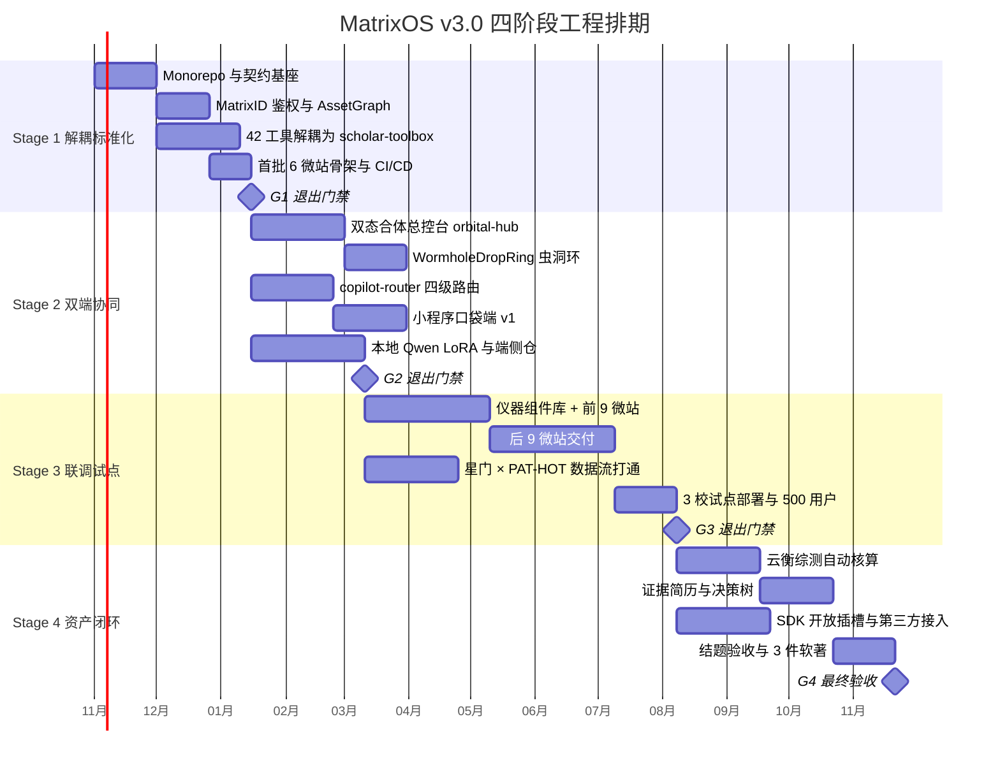

# MatrixOS v3.0 四阶段工程路线图

> 文档编号：docs/01-plan/02-roadmap.md
> 上游依据：`bundle/MatrixOS_v3_完整交互规范与UI图谱_高清版.html`（v3 权威源，见 ADR-000）、`01-architecture.md`
> 四阶段的时间切分（2/3/4/3 月）沿用 v2 旧稿的月份长度，但内容、交付物、验收标准全部按 v3 体系重写
> 任务级明细见 `03-work-breakdown.md`，风险明细见 `05-risks.md`

---

## 0. 总览

总工期 **12 个月**（2 + 3 + 4 + 3），四阶段为**串行主干 + 阶段内并行**。阶段之间不是瀑布式硬门禁，而是**四项硬性退出门禁（Exit Gate）**——门禁不过，下一阶段不得开工，但下一阶段的**准备性任务**（环境搭建、契约草拟、三校谈判）可提前启动。

**工期与人力假设（写死，便于核算）：**

| 项 | 假设值 | 说明 |
| :--- | :--- | :--- |
| 团队规模 | 6 人 | 1 架构/Tech Lead + 3 全栈 + 1 前端/视觉 + 1 算法/数据 |
| 有效工作日 | 每月 20 天 | 不含假期 |
| 并行度 | Stage 1: 3 路，Stage 2: 3–4 路，Stage 3: 4 路，Stage 4: 2–3 路 | 受 6 人上限与代码评审带宽约束 |
| 缓冲 | 每阶段预留 15% | 已含在上表里程碑日期中 |

---

## Stage 1 · 解耦标准化（2 个月）

### S1-目标

把「四个各自为政的原型」变成「一个有统一契约、统一身份、可被 18 个前端消费的工具底座」。**这一阶段不追求任何用户可见的新 UI**——它的价值在于此后所有微站开发不再重复造轮子。

一句话验收：**任意一个新微站，能在 1 天内基于脚手架接到统一鉴权与资产底座并跑通 CI。**

### S1-交付物

| # | 交付物 | 形态 | 负责角色 |
| :--- | :--- | :--- | :--- |
| D1.1 | Turborepo monorepo 骨架（`apps/` `packages/` `services/` `specs/` `infra/` `e2e/`） | 可 `pnpm install && pnpm build` 的仓库 | TL |
| D1.2 | `packages/twin-schema`：三份已冻结 schema（wormhole / manifest / dispatch）的 TS 类型 + 运行时校验器 + `AssetNode` 契约 | npm 私有包 | BE1 |
| D1.3 | `services/matrix-core`：MatrixID 鉴权（授权码 + JWT + 轮转）、`/v1/assets` CRUD、`/v1/registry/manifests` | FastAPI 服务 + OpenAPI | BE2 |
| D1.4 | PostgreSQL 16 + pgvector 实例与迁移（`asset_node` / `asset_edge` / `asset_chunk`） | Alembic 迁移 + seed 脚本 | BE2 |
| D1.5 | `services/scholar-toolbox`：42+ 工具中 **P0 的 20 个**完成无状态化封装 | FastAPI 服务 + 工具清单 | DS |
| D1.6 | 微站脚手架 `pnpm gen:site --id=07 --domain=lit-sonar` 一键生成 | Turborepo generator | BE1 |
| D1.7 | 6 个微站骨架（01 / 04 / 06 / 09 / 11 / 16，四大原型各自的代表作）跑通鉴权 + 资产读写 | 可访问的部署 | BE1 + BE3 + FE |
| D1.8 | CI/CD：lint + typecheck + 契约漂移检查 + 预览部署 | GitHub Actions | TL |
| D1.9 | 观测基座：OpenTelemetry + 结构化日志 + `trace_id` 贯穿 | 可查的 Jaeger | TL |

### S1-验收标准（Exit Gate G1，全部必须满足）

1. **契约单一源**：`specs/contracts/` 下的 schema 变更若未同步生成 TS 类型与 Python 模型，CI **必须**红。用一次故意的破坏性提交验证（回滚后 CI 转绿）。验证人：TL。
2. **鉴权闭环**：从 `orbital-hub` 登录 → 访问 `curvelab.matrixos.edu` → 调用 `/v1/assets` 写入 → 在另一站读到同一条资产，全链路无需二次登录。录屏 + Playwright E2E 用例通过。
3. **资产图谱可用**：给定一条 `asset_node`，能通过 `asset_edge` 在 2 跳内找到其溯源论文与证据锚点；`/v1/assets/search` 的向量检索 top-5 命中率在标注集（≥ 100 条）上 ≥ 80%。
4. **工具池就绪**：20 个 P0 工具全部有 OpenAPI 文档、单测覆盖率 ≥ 70%、单次调用 P95 < 3s（不含 LLM 生成类）、且**全部无状态**（同一输入重复调用结果一致，或明确标注为非确定性并给出 seed）。
5. **脚手架可用**：真实计时——从 `pnpm gen:site` 到新站部署出可访问 URL，**≤ 1 人日**。由未参与脚手架开发的工程师执行（避免作者盲区）。
6. **可观测**：任取一次 API 调用，能在 Jaeger 看到 `trace_id` 贯穿 hub → core → toolbox 的完整链路。
7. **不留技术债尾巴**：`turbo build` 全仓通过，`tsc --noEmit` 零错误，无 `@ts-ignore`（如有必须在 PR 说明并登记到 `05-risks.md`）。

### S1-关键风险

| 风险 | 说明 | 缓解 |
| :--- | :--- | :--- |
| 42 工具解耦工作量被低估 | 原型里工具可能互相耦合、共享全局状态，无状态化改造可能触发连锁重构 | 先做「耦合度扫描」（`S1-07e`），按耦合度排序，只承诺 P0 20 个进 S1 |
| 四原型数据不可迁移 | 旧数据无 `matrix_uid`、无结构化证据锚点 | S1 只做**新数据**入图；旧数据迁移单列 `S1-13`，允许「只迁元数据 + 正文留原处」的降级方案 |
| schema 反复 | 虫洞契约是 18 站共同依赖，改一次全员返工 | 三份契约**已冻结**（`specs/contracts/`），S1 内不再改字段语义；变更走 ADR-10 版本化 |

### S1-依赖关系

- **无前置阶段依赖。** 强依赖两项外部输入：
  - `specs/microsites.json` 花名册已冻结（已就绪）
  - 校园 CAS / 微信开放平台的**应用资质**（`S1-03e` 需要；若审批未下则先用邮箱 + 密码兜底，不阻塞）

### S1-可演示成果（对评审/答辩）

S1 结束时能演示：一个真实的「登录 → 在 6 个站之间自由切换 → 数据跟着人走」的闭环。**这是整个项目可信度的第一个证明点**，建议安排一次内部 Demo。

---

## Stage 2 · 双端协同 + 模型微调（3 个月）

### S2-目标

让「18 个独立微站」在体验上**合体**为一个工作台，并在移动端提供真正符合「碎片化」场景的伴侣形态。同时把 AI 成本压到可承受区间。

一句话验收：**在 hub 左星轨点一个站 → 右侧仪器架挂载 → 拖动拟合结果经虫洞环投送到星门 → 手机上收到面试提醒，全程零文件导入导出。**

### S2-交付物

| # | 交付物 | 形态 | 负责角色 |
| :--- | :--- | :--- | :--- |
| D2.1 | `apps/orbital-hub`：左 32% 2.5D 星轨（7 轨 18 胶囊，实时微缩态）+ 右 68% 折射仪器架（同屏 2–3 站）+ 底部声波坞 | Next.js 15 应用 | FE + BE3 |
| D2.2 | `packages/matrix-sdk`：`initSSO()` / `onWormholeDrop()` / `emitAsset()` / `useHostBridge()` + `WormholeDropRing` | npm 私有包 | BE1 |
| D2.3 | iframe 宿主/租户握手 + `mx_idt` 交换机制（解决第三方 Cookie 限制） | SDK 能力 + `/v1/auth/exchange` | BE1 + BE2 |
| D2.4 | `services/copilot-router`：四级模型路由 + DAG 编排 + schema 自愈 + 成本记账与熔断 | FastAPI 服务 | DS |
| D2.5 | 本地 Qwen 3.8-7B LoRA 微调（物理/光电术语校准 + 导师匹配向量对齐） | 模型权重 + 推理服务 | DS |
| D2.6 | 端侧 IndexedDB 隐私仓（AES-GCM + PBKDF2 密钥派生） | SDK 能力 | BE1 |
| D2.7 | `apps/wechat-pocket` v1：08:00 三卡早报、进组提醒、一键推入桌面队列、学术名片 | 微信小程序 | FE + BE3 |
| D2.8 | WebSocket 双端同步通道（桌面 ↔ 小程序队列） | `matrix-core` 能力 | BE2 |
| D2.9 | `packages/instrument-ui` v0.5：阻尼旋钮、Canvas 荧光示波器、360° 声呐盘、激光连线表格 | npm 私有包 | FE |

### S2-验收标准（Exit Gate G2）

1. **双态合体性能**：hub 首屏 LCP < 2.5s（4G 模拟），星轨动画稳定 60fps（Chrome DevTools Performance 录制 10s，掉帧 < 3 帧），同屏挂载 3 个 iframe 时主线程长任务 < 50ms。
2. **虫洞闭环**：完成一次真实的 `curve_fit_parameters`（CurveLab → 星门套磁），满足：
   - envelope 通过 `specs/contracts/wormhole-envelope.schema.json` 校验；
   - `evidence_anchors` 非空且含 DOI + `pdf_page` + `bbox`；
   - 目标站正确消费并写入资产，`trace_id` 可查；
   - **负例**：缺 `evidence_anchors` 时环体变红并拒绝投送。
3. **零文件导入导出**：整个虫洞流程中，浏览器下载目录与剪贴板**无任何文件产生**（E2E 断言）。
4. **模型分级生效**：构造 3 类请求（意图分类 / JSON 校验自愈 / 长文本对比），日志中 `model_tier` 分别为 `flash` / `flash` / `pro`，且**路由准确率 ≥ 95%**（标注集 200 条）。
5. **成本达标**：以 100 名模拟用户的 1 个月行为日志回放，折算**单用户年均 API 成本 < ¥1.5**。若超标，必须有明确的降级方案（路由比例调整 / 缓存命中率提升）并复测。
6. **小程序冷启动**：真机（中端安卓，如 Redmi Note 系列）冷启动 < 800ms，3 次取均值。
7. **端侧隐私**：断网状态下，CurveLab 仍可打开并展示本地缓存数据（离线优先）；抓包确认原始实验数据无任何外发请求。

### S2-关键风险

| 风险 | 说明 | 缓解 |
| :--- | :--- | :--- |
| 多 iframe 性能崩塌 | 3 个 Next.js 应用同屏 = 3 份 React 运行时 + 3 份 SDK | S2 第 2 周先做**性能探针**（`S2-01e`），若超预算则降级为「1 主 + 2 静态快照」，视觉不破 |
| 第三方 Cookie 政策 | Chrome/Safari 收紧后，iframe 内 Cookie 不生效 | D2.3 的 `mx_idt` 交换机制**是必做项不是优化项**；S2 第 1 周就验证 |
| 模型路由准确率不达标 | 意图分类错误导致 Pro 被滥用，直接击穿 ¥1.5 成本线 | 路由层加**成本熔断**：单用户日成本超阈值自动降级到 flash，并记录降级事件 |
| LoRA 微调效果不确定 | 校内算力有限，数据量不足可能训不出可用模型 | LoRA 定位为**增强而非必需**：未达标时回退到 Qwen 3.8 Flash + prompt 工程，架构不变 |
| 小程序审核周期 | 微信审核不可控，可能卡在类目资质 | S2 第 1 周即提交首个测试版本，预留 3 周缓冲；用「体验版」先行内测 |

### S2-依赖关系

- **硬依赖 S1 的 G1 全部通过**，特别是 D1.2（schema）、D1.3（鉴权）、D1.6（脚手架）。
- D2.5（LoRA）依赖校内 GPU 资源到位，**可与其它任务并行**，不阻塞 G2 的 1–4、6–7 项。
- D2.7（小程序）依赖微信开放平台资质，与 `S1-03e` 的资质申请是同一件事。

---

## Stage 3 · 原型联调与试点部署（4 个月）

### S3-目标

补齐剩余 12 个微站，把组件库做扎实，然后在真实高校场景里跑起来。**这一阶段的核心不是写代码，而是让真实用户用起来并暴露问题。**

一句话验收：**3 所高校、500+ 真实用户、连续 4 周稳定运行，核心链路可用率 ≥ 99%。**

### S3-交付物

| # | 交付物 | 形态 | 负责角色 |
| :--- | :--- | :--- | :--- |
| D3.1 | 剩余 12 个微站（02 / 03 / 05 / 07 / 08 / 10 / 12 / 13 / 14 / 15 / 17 / 18）交付上线 | 12 个独立部署 | BE1 + BE2 + BE3 + FE |
| D3.2 | `packages/instrument-ui` v1.0：四大仪器族完备（旋钮族 / 图表族 / 雷达族 / 天平族）+ Storybook | npm 私有包 + 文档站 | FE |
| D3.3 | 星门 × PAT-HOT 数据流打通：导师画像 ↔ 前沿情报 ↔ 套磁信三者联动 | 跨站工作流 | DS + BE2 |
| D3.4 | 试点部署：3 所高校物理/光电实验室，500+ 种子用户 | 生产环境 | TL |
| D3.5 | 灰度与回滚机制（按微站维度的独立发布 + 一键回滚） | 部署流水线 | TL |
| D3.6 | 用户反馈闭环：埋点 + 反馈入口 + 每周迭代节奏 | 数据看板 | BE3 |
| D3.7 | 压测报告与容量规划（500 → 5000 用户的扩容路径） | 文档 + 脚本 | TL |

### S3-验收标准（Exit Gate G3）

1. **18 站全量在线**：18 个微站全部可访问，且**逐站**满足 12 项站点验收模板（见 `03-work-breakdown.md` §S3-E2），包括：独立台账可读写导出、可被 hub 挂载、能参与虫洞收发（各 ≥ 1 个类型）、有 E2E 用例。
2. **试点指标**：
   - 500+ 注册用户，其中 **≥ 200 人周活**（≥ 40% 周活率）；
   - 连续 4 周，核心链路（登录 / 资产读写 / 虫洞投送）可用率 ≥ 99%；
   - 用户留存：次周留存 ≥ 35%。
3. **稳定性**：4 周内 P0 故障（全站不可用）0 次，P1 故障（单站不可用）< 3 次且每次恢复 < 30 分钟。
4. **性能不退**：18 站齐聚后，hub 首屏 LCP 仍 < 2.5s（星轨胶囊从 18 增至 18 + N 时不得线性劣化）。
5. **组件库可用**：`instrument-ui` 的 4 大仪器族中，每族至少 2 个组件被 ≥ 2 个微站复用（避免「组件库建了没人用」）。
6. **反馈闭环**：每周有 1 次基于真实反馈的迭代发布，累计 ≥ 12 次。

### S3-关键风险

| 风险 | 说明 | 缓解 |
| :--- | :--- | :--- |
| 12 站并行开发导致质量参差 | 4 个月交付 12 站，容易出现「能跑就行」 | 强制站点验收模板（12 项）+ 每站必须过 E2E；组件复用率纳入验收 |
| 试点用户不活跃 | 学生用户新鲜感过后流失，500 用户变僵尸 | 与课程/大创绑定（真实刚需场景），而非纯拉新；设 08:00 早报作为每日触点 |
| 三校环境差异 | 网络策略、CAS 对接方式、浏览器版本各异 | 每校配 1 名对接人；S3 第 1 月完成三校环境勘察并出差异矩阵 |
| 数据合规审查 | 学生数据 + 学术数据，涉及个人信息保护 | S3 前完成合规自查清单（见 `05-risks.md` R-C01），试点前签署知情同意 |
| 18 站运维成本 | 18 个独立部署 = 18 份监控/告警/回滚 | 统一部署模板 + 统一观测；`S3-20` 的灰度机制必须在第 1 月就位 |

### S3-依赖关系

- **硬依赖 G2 全部通过**（特别是虫洞、鉴权、hub 性能）。
- D3.1 的 12 站依赖 D3.2 组件库的对应仪器族；因此组件库排在前 2 个月，12 站分两批交付（第 2 月 9 站、第 4 月 9 站，含 S1 已交付骨架的 6 站完功能）。
- D3.4 试点依赖三校的合作协议，**需在 S2 期间启动谈判**，否则 S3 会被卡住。

---

## Stage 4 · 资产闭环与立项验收（3 个月）

### S4-目标

打通「科研过程 → 学术资产 → 综测加分 / 求职竞争力」这条价值闭环——**这是整个项目区别于「一堆好用的工具」的根本理由**，也是大创结题的核心叙事。

一句话验收：**学生在 CurveLab 做的一次拟合，能自动变成云衡综测的一笔加分材料，和证据简历里一条带 DOI 绿标的经历。**

### S4-交付物

| # | 交付物 | 形态 | 负责角色 |
| :--- | :--- | :--- | :--- |
| D4.1 | 云衡综测自动核算（16 号站）：资产 → 加分项映射、按高校细则配重、导出申报 PDF 包 | 完整功能 | BE2 |
| D4.2 | 证据简历工坊（17 号站）：DOI / 拟合图 / 代码仓库哈希三重验真，可导出 PDF/在线页 | 完整功能 | BE3 |
| D4.3 | 生涯多重宇宙决策树（18 号站）：基于资产底座的期望收益推演 | 完整功能 | DS |
| D4.4 | `@matrixos/sdk` 开放插槽 v1.0：`matrix-app-manifest.json` 校验器 + 第三方热插拔 | npm 包 + 接入文档 | BE1 |
| D4.5 | **外部实验室接入验证**：至少 1 个真实第三方课题组微站通过 SDK 挂载成功 | 案例 | BE3 |
| D4.6 | 大创结题报告 + 答辩材料 | 文档 | TL |
| D4.7 | **3 件软件著作权**申请材料（源码 + 说明书 + 申请表） | 提交件 | TL |
| D4.8 | 运维交接文档（部署 / 排障 / 扩容 / 成本） | 文档 | TL |

### S4-验收标准（Exit Gate G4 / 最终验收）

1. **资产闭环端到端**：真实走一遍「CurveLab 拟合 → 虫洞投送星门 → 套磁信引用 → 云衡综测加分 → 证据简历呈现」，全链路**无人工搬运数据**。录屏 + E2E 用例。
2. **综测核算准确性**：对 ≥ 3 所高校的综测细则各实现一套映射规则，用 30 个构造用例验证，加分计算**零错误**；错一个即不算通过。
3. **简历验真有效**：简历中每条经历的证据锚点可点击跳转到原文位置（DOI + PDF 页 + 坐标）；抽检 50 条，**断链率 0**。
4. **第三方可接入**：一个**未参与本项目**的开发者，仅凭接入文档，在 **≤ 2 人日**内完成一个微站的挂载并通过 manifest 校验。这是 SDK 可用的唯一可信证明。
5. **成本终验**：基于生产环境真实用量，**单用户年均 API 成本 < ¥1.5**。
6. **软著 3 件**：3 件申请材料齐备并提交（受理即算达成，授权周期不受控）。
   - 建议拆分：① MatrixOS 群岛式微站调度与虫洞投送系统；② 数字孪生学术资产图谱管理与综测核算系统；③ 精密科研仪器前端组件库。
7. **文档完备**：`docs/02-engineering/` 下含架构说明、API 文档、运维手册、开发者接入指南，且**由未曾参与对应模块的工程师验证可照做**。

### S4-关键风险

| 风险 | 说明 | 缓解 |
| :--- | :--- | :--- |
| 综测细则各校不同且不公开 | 高校综测规则存在大量院系级差异，难以通用化 | S4 只承诺 3 所试点校的细则；其余学校提供**规则编辑器**由校方自行配置，不承诺开箱即用 |
| 软著审查周期不可控 | 通常 3–6 个月，可能赶不上结题 | S4 第 1 月即提交，不等功能全完备（软著只要求代码 + 说明书，不要求上线） |
| 第三方接入验证找不到对象 | 需要真实外部实验室配合 | S3 期间就物色 2–3 个候选课题组（试点校内的其他 PI），S3 末锁定 |
| 结题材料与工程交付冲突 | 团队精力被答辩材料分散 | D4.6/D4.7 由 TL 独立承担，不占用 3 名全栈的开发时间 |

### S4-依赖关系

- **硬依赖 G3 全部通过**（特别是 18 站在线、资产数据真实存在）。
- D4.1/D4.2/D4.3 依赖 S1 建成的 `asset_node` / `asset_edge` 图结构，若 S1 的图模型设计有偏差，此处会付出返工代价 → **S1 的图模型评审是本项目最关键的架构决策点**。
- D4.4/D4.5 依赖 S2 的 SDK 基础能力。

---

## 附：阶段退出门禁汇总

| 门禁 | 时点 | 一票否决项（任一不过即不得进入下一阶段） |
| :--- | :--- | :--- |
| **G1** | 第 2 月末 | 契约漂移 CI 无效 / 跨站免登失败 / 脚手架 > 1 人日 / 工具池非无状态 |
| **G2** | 第 5 月末 | 虫洞无证据锚点仍可投送 / 成本 > ¥1.5 / hub 性能超预算且无降级 / 小程序冷启动 > 800ms |
| **G3** | 第 9 月末 | 18 站未全在线 / 试点 < 500 用户或周活 < 200 / 4 周内出现 P0 故障 / 可用率 < 99% |
| **G4** | 第 12 月末 | 资产闭环需人工搬运 / 综测计算有错 / 简历断链 / 第三方接入 > 2 人日 / 成本超标 / 软著未提交 |

**门禁执行方式**：每阶段末由 TL 组织「验收演示 + 证据核对」，证据必须可复现（E2E 用例、监控截图、真实数据），**不接受口头声明**。未通过则本阶段延期，且必须在 `05-risks.md` 登记实际风险事件。

---

## 附：Backlog（不进入四阶段交付，登记待议）

| ID | 项 | 来源 | 状态 |
| :--- | :--- | :--- | :--- |
| BL-01 | `journal-compass` 投稿期刊罗盘微站 | 蓝图 §3 目录清单提及，但 `specs/microsites.json` 花名册无此站 | 待议：若上，走 SDK 开放插槽挂载为第 19 站，不占官方 18 席 |
| BL-02 | 课题组私有化部署 SOP 版本（B 端 ¥1.5 万/个） | 蓝图财务测算提及 | 待议：商业模式项，非 v3 工程范围 |
| BL-03 | C 端 Pro 算力包订阅体系 | 蓝图财务测算提及 | 待议：需支付与计费体系，v3 不含 |
